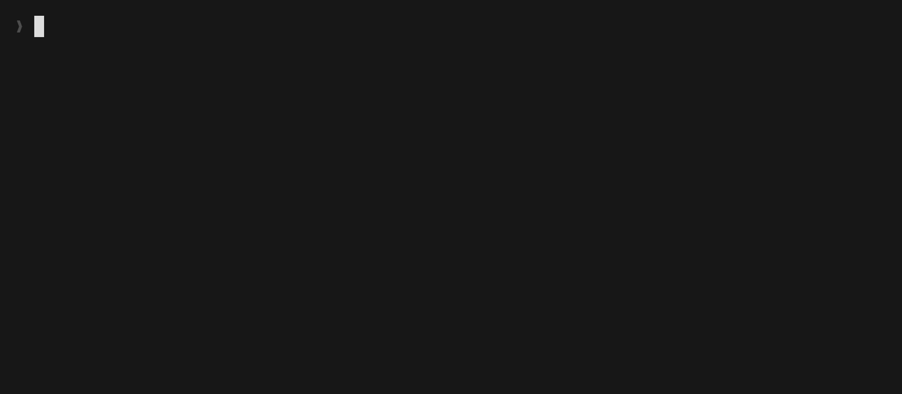

<div align="left">

# feago

**Feature-first Rojo project generator for Roblox.**


</div>



## Why feago

Realm-first layouts (`src/server/`, `src/client/`, `src/shared/`) scatter one feature across three folders. Open a feature, jump three places.

feago lets you keep everything for a feature in its own folder, mixed realms and all, and works out the Rojo project file from there. Works with plain Luau and [roblox-ts](#roblox-ts).

## Quickstart

```sh
rokit add afrxo/feago
feago init && feago watch
```

## Install

**Rokit** (per-project, recommended):

```sh
rokit add afrxo/feago
```

**Homebrew** (macOS, global):

```sh
brew install --cask afrxo/tap/feago
```

**Prebuilt binary:** [releases page](https://github.com/afrxo/feago/releases).

## How realm gets decided

For each `.luau` file (and `.ts`/`.tsx` in [roblox-ts](#roblox-ts) projects), feago checks in order, stopping at the first match:

1. Filename suffix, same as Rojo: `*.server.luau`, `*.client.luau`.
2. First-line directive: `--@load:server`, `--@load:client`, `--@load:shared`, `--@load:preload`.
3. Closest `.feago` folder config walking up the tree.
4. Default: shared.

> [!IMPORTANT]
> A directive beats the filename suffix. `*.client.luau` with `--@load:preload` on the first line maps to preload (`ReplicatedFirst`), not client.

Realms map to services:

| Realm   | Rojo destination                |
|---------|---------------------------------|
| Server  | `ServerScriptService`           |
| Client  | `ReplicatedStorage/Client`      |
| Shared  | `ReplicatedStorage/Shared`      |
| Preload | `ReplicatedFirst`               |

> [!NOTE]
> These destinations are hardcoded for now. Making them configurable per project is planned.

### The `.feago` folder config

Drop a `.feago` file into a folder to set the default realm for every `.luau` under it. Per-file suffixes and directives still win.

```ini
# src/inventory/.feago
realm = shared
```

Valid values: `server`, `client`, `shared`, `preload`. Lines starting with `#` are comments.

> [!CAUTION]
> Folder default loses to per-file overrides. A stray `combat.server.luau` inside a folder with `realm = client` still goes to the server.

## roblox-ts

```sh
feago init game --ts
cd game && npm install
```

Then keep three watchers running: `npx rbxtsc -w`, `feago watch`, and `rojo serve`.

A project with a `tsconfig.json` next to its project file is treated as roblox-ts:

- Sources come from tsconfig's `rootDir`, and each `$path` points at the compiled file in `outDir`: `src/Combat/Damage.ts` maps to `out/Combat/Damage.luau`.
- Realms work the same, with TypeScript spellings: `*.server.ts`, `*.client.ts` (`.tsx` too), and `//@load:server` directives.
- `index.ts` compiles to `init.luau`, so a folder with an `index.ts` maps as one module.
- `.luau` files under `rootDir` are mapped too, since rbxtsc copies them to `outDir`. `.d.ts` files are skipped.

rbxtsc resolves imports from the same project file, so `import { greet } from "./Greet"` compiles to the right DataModel path across realms, and importing a server module from client or shared code is a compile error.

> [!NOTE]
> Compiled files are mapped as Rojo `optional` paths, so Rojo keeps serving while a file hasn't compiled yet. `feago watch` also watches `outDir` and rewrites the project file when rbxtsc emits a new file, which is what makes Rojo pick it up. If rbxtsc ever reports `Could not find Rojo data` for a file you just added, it compiled before feago mapped it: save the file again.

> [!IMPORTANT]
> Moving an existing roblox-ts project over? Delete the template's `TS` entries (`out/server`, `out/shared`, `out/client`) from the project file and move code into feature folders. Keep `rbxts_include`. feago only rewrites the destinations listed above and leaves the rest of the project file alone.

## Commands

- **`feago init [dir] [--force] [--ts]`**: scaffold a project (`--ts` for roblox-ts)
- **`feago build [source] [--project <file>]`**: build once
- **`feago watch [source] [--project <file>]`**: rebuild on changes
- **`feago version`**: print version
- **`feago help [command]`**: show help

Run `feago help <command>` for full usage.

## Contributing

Open an [issue](https://github.com/afrxo/feago/issues) for bugs, ideas, or design discussion before a PR.

Build locally with `go build ./cmd/feago` and run the tests with `go test ./...`.

## License

MIT. See [LICENSE](LICENSE).
